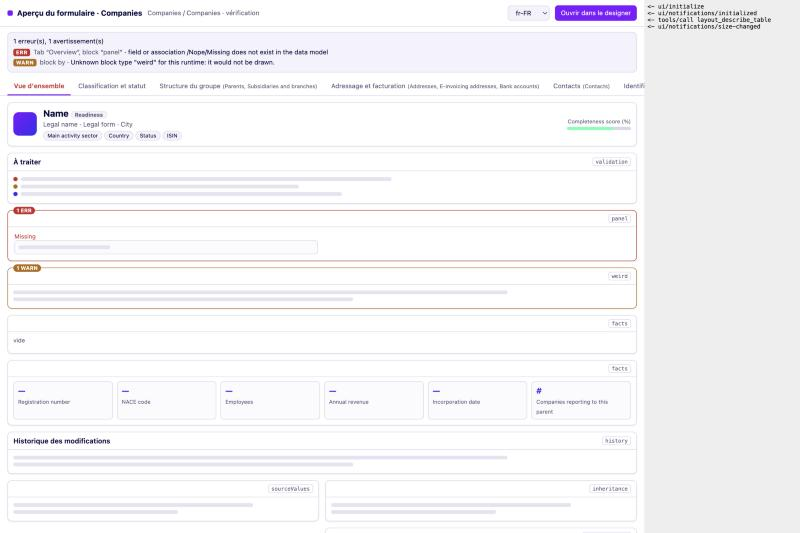
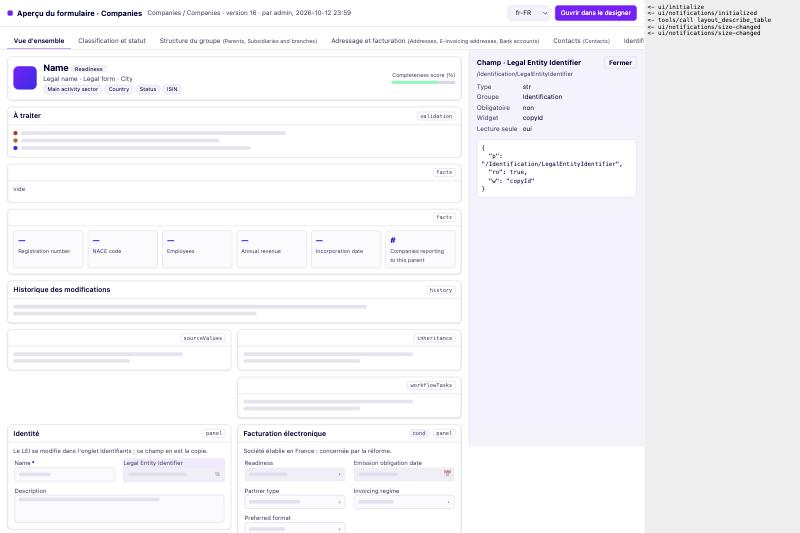
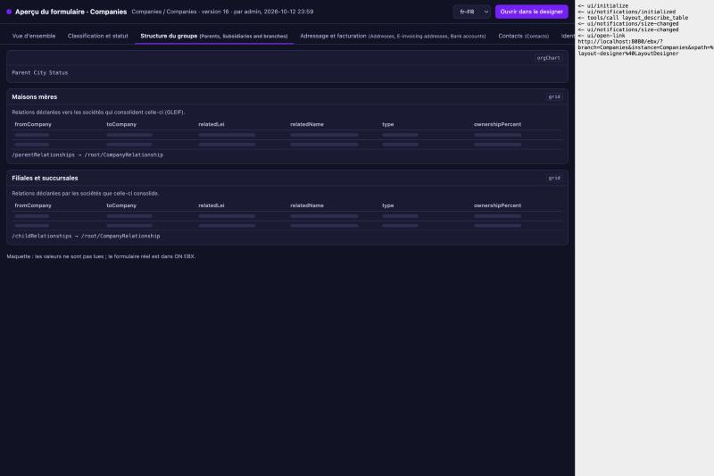

# MCP server (1.21.0)

The module serves an MCP server so that an agent (Claude Code, the EBX assistant, any MCP client) can design record
forms and explorers the way an administrator does in the designer pages, with the same storage and the same checks.

- Endpoint: `POST /ebx-layout-designer/rest/mcp` — MCP over streamable HTTP, JSON answers (JSON-RPC 2.0), no server-sent
  events; `GET` and `DELETE` answer `405` with `Allow: POST,OPTIONS`, which MCP clients need to fall back to plain
  request/response. A custom module cannot register a native EBX MCP server (`/ebx-assistant/mcp/v1/…`, core and add-on
  modules only), hence this endpoint on the EBX REST Toolkit.
- Authentication: any EBX REST authentication (Basic, token, session). **Administrators only**, like the designer pages:
  anyone else gets an empty tool list. A request whose `Origin` names another site is refused (a browser signed in to EBX
  cannot be made to post a layout).
- Turned off with the JVM option `-Debx.layoutDesigner.mcp=false` (the endpoint then answers 404).

Client configuration (Claude Code, `~/.claude.json` or `.mcp.json`):

```json
"ebx-layout-designer": {
  "type": "http",
  "url": "http://localhost:8080/ebx-layout-designer/rest/mcp",
  "headers": {"Authorization": "Basic <base64 of login:password>"}
}
```

## Tools

| Tool | Writes | What it does |
|---|---|---|
| `layout_help` | | the workflow; `topic: forms` / `explorers` returns the full formats ([LAYOUT-FORMAT.md](LAYOUT-FORMAT.md), [EXPLORER-FORMAT.md](EXPLORER-FORMAT.md)) |
| `layout_describe_table` | | fields (path, label, type, group, enumeration values, foreign key target), groups, associations with their table and fields, the dataset's tables, locales, registered components, published workflows, the stored form and the table's explorers, whether the model declares the designed form; Match and Merge's technical nodes flagged |
| `layout_get` | | the stored record form layout, version, who saved it |
| `layout_starter` | | the designer's starting layout (one panel per group, one tab per association), technical associations left out |
| `layout_validate` | | shape, block types and ids, then every field, association, table, workflow and component named (`LayoutCheck`, the same check as the `FormLayout` table's validation) |
| `layout_put` | yes | checks, then saves (version + 1); refused on an error or when `expected_version` differs from the stored one; `dry_run` |
| `explorer_list`, `explorer_get` | | the explorers (all, or a table's), one explorer's JSON |
| `explorer_validate` | | every path, computed value, facet, flag, tile, sort, group, card part and action, and whether EBX can evaluate each filter (`ExplorerCheck`) |
| `explorer_put` | yes | checks, then creates or replaces an explorer; `label`, `active`, `expected_version`, `dry_run`; answers its id and address |

Every answer is a JSON object (`structuredContent`); a refused call carries `error` and `code` (`FORBIDDEN`, `NOT_FOUND`,
`MISSING_ARGUMENT`, `INVALID_JSON`, `INVALID`, `VERSION_CONFLICT`, `WRONG_TABLE`) and `isError: true`.

## What the checks add to the pages

The pages never refuse a stored layout or explorer: they skip what they cannot draw, with at most a line in `kernel.log`.
The MCP checks say it before saving:

- a path the table (or the linked table) does not define;
- an explorer filter EBX cannot evaluate as one query (a media sub-field such as `/Logo/attachment`, a `provided` value);
  the page would drop the flag and its tile;
- a facet, sort or group on something EBX cannot filter or sort (a group, an association, a `provided` value);
- tiles naming a flag or facet that does not exist, duplicate ids, unknown kinds, widgets, tones and block types;
- a workflow button whose publication is not published on this instance (warning).

The record form is used once the model declares `com.on.ebx.layout.runtime.ConfigurableForm`: `activation` in the
answers says whether it does, and how (DMA: `set_form_layout` + `publish_data_model` on the `data-model` server; module
model: `xsdLine`, the line to add to the table's `osd:table` in the module's XSD, read by EBX at its next start).
`designerWritesXsd` says whether the designer's *Activate* button may write that line on this server
(`-Debx.layoutDesigner.xsdActivation=true`, off by default since 1.30.0).

Worked example: [examples/companies-explorer.json](examples/companies-explorer.json), the FastTrack Companies explorer
(632 companies, six tiles, eleven facets, groups by sector) rebuilt from the Java `CompanyExplorer` service.

## Form preview (MCP Apps, 1.27.0, prototype)

A host that supports MCP Apps (extension `io.modelcontextprotocol/ui`, spec 2026-01-26) draws the record form a layout
describes next to the answer of `layout_get`, `layout_starter` and `layout_validate`. The page is a mock-up: tabs, rows of
one or two columns, panels with their fields (label, required mark, widget, read-only), hero, facts, association grids and
the validation block drawn for what they are, other blocks as a card naming what they refer to. No value is read.

- **Resource:** `ui://ebx-layout-designer/form-preview`, mime type `text/html;profile=mcp-app`, embedded in the module
  (`mcp/form-preview.html`, no external script, style or font: the host's default CSP applies). Listed and read for
  administrators only, like the tools.
- **Declaration:** `initialize` declares `resources` and `extensions.io.modelcontextprotocol/ui`. The three read-only tools
  carry `_meta.ui.resourceUri` (and the flat pre-GA key `_meta["ui/resourceUri"]`) with `visibility: ["model","app"]`.
  `layout_put` and the explorer tools carry nothing.
- **Labels:** the page calls `layout_describe_table` through the host (`tools/call`), so the read runs under the caller's
  session and rights. The page itself holds no EBX session.
- **Check findings:** for `layout_validate`, the layout is the tool's input; each error or warning is placed on the block or
  field it names (tab label, block id or type, model path in the text). What cannot be placed stays in the list on top.
- **Designer link:** the answers now carry `designerLink`, the absolute address of the designer on the table (built from the
  address the caller reached the server with). The button opens it through the host (`ui/open-link`).
- **Interaction:** a click on a field or block shows its model facts (type, group, required, enumeration, foreign key
  target) and its JSON in a side panel. A locale switcher follows `layout.locales`. Light and dark themes follow the host.

Where it renders: the Claude desktop **chat**, for servers of its own configuration file (stdio). Claude Code and the
desktop Code tab show the text answer only. A stdio bridge to this endpoint is the catalog's `tools/mcp_stdio_bridge.py`
(standard library only, the `Authorization` header taken from the environment):

```json
"ebx-layout-designer": {
  "command": "/usr/bin/python3",
  "args": ["<path>/mcp_stdio_bridge.py", "http://localhost:8080/ebx-layout-designer/rest/mcp"],
  "env": {"EBX_MCP_AUTHORIZATION": "Basic <base64 of login:password>"}
}
```

Edit `claude_desktop_config.json` with the app quit: the app rewrites it from memory.





## Limits

Only administrators are served: anyone else gets 403 before the request body is read. The body is limited to 2 MB (413;
`-Debx.layoutDesigner.mcp.maxBodyBytes`), JSON nesting to 64 levels (400; `-Debx.layoutDesigner.mcp.maxDepth`, also applied to a
`layout`/`explorer` passed as a string), a batch to 50 requests. A failing tool answers `FAILED` without the exception text;
the detail is in `kernel.log`.
